# Phishing Detector on AWS

A rule-based email phishing detector (Part 1) deployed as a highly available, monitored web application on AWS with Terraform (Part 2).

- **Part 1:** `app/` reads an email from a text file or a web form, flags phishing indicators, gives a risk score and a verdict, and keeps a history of checks.
- **Part 2:** `infra/` creates the whole environment with Terraform: a VPC across two Availability Zones, two EC2 instances behind an Application Load Balancer, Amazon RDS PostgreSQL for the history, an ElastiCache Redis cache in front of it (bonus), and CloudWatch logs, metrics, alarms and a dashboard.

---

## Architecture

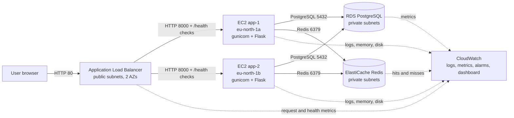

| Layer | Resource | Why |
|---|---|---|
| Network | VPC `10.0.0.0/16`, 2 public + 2 private subnets in 2 AZs | Survive the loss of one AZ. RDS lives in private subnets with no route to the internet. |
| Entry point | Application Load Balancer, listener on port 80 | One public address; spreads requests and stops sending to unhealthy servers. |
| Compute | 2 × `t3.micro` Amazon Linux 2023, one per AZ | The app runs under gunicorn, managed by systemd (restarts on crash). |
| Data | RDS PostgreSQL 16, `db.t3.micro`, encrypted, not public | One shared history for both servers. |
| Cache (bonus) | ElastiCache Redis 7.1, one `cache.t3.micro` node, private subnets | Serves the history table from memory, so most page views never reach RDS. |
| Monitoring | CloudWatch log group, metric filter, 4 alarms, dashboard | See health, load, errors and logs in one place. |
| Access | IAM role with 2 AWS managed policies, SSM Session Manager | No SSH port, no keys on the servers. |

---

## Repository layout

```
app/
  detector.py          Detection rules, risk score and verdict; also a command-line tool
  db.py                History storage: SQLite locally, PostgreSQL on RDS when DB_HOST is set
  cache.py             Shared Redis cache (ElastiCache) when REDIS_HOST is set; falls back to the database if Redis is down
  app.py               Flask web app: upload or paste an email, see the result and recent checks; /health for the ALB
  templates/index.html The web page
  samples/             Example emails: phishing, suspicious, safe, malicious attachment
  test_detector.py     Unit tests for the rules and the sample verdicts
  requirements.txt     Pinned dependencies (flask, gunicorn, psycopg2-binary, redis)
infra/
  versions.tf          Terraform and provider versions, region, default tags
  variables.tf         Inputs (region, sizes, DB name/user); db_password is sensitive
  network.tf           VPC, subnets, internet gateway, route table
  security.tf          Security groups: internet -> ALB -> EC2 -> RDS (Redis's group is in cache.tf)
  database.tf          RDS subnet group and PostgreSQL instance
  cache.tf             ElastiCache Redis: security group, subnet group, one-node cluster
  compute.tf           IAM role, cloud-init user data, the two EC2 instances
  alb.tf               Load balancer, target group with health check, listener
  monitoring.tf        Log group, metric filter, alarms, dashboard
  outputs.tf           App URL, dashboard link, instance IDs, RDS and Redis endpoints
  templates/setup.sh   First-boot install script (Python, app, CloudWatch agent)
  templates/phishing.service  systemd unit that runs gunicorn
  terraform.tfvars.example    Template for the git-ignored terraform.tfvars
docs/screenshots/      Screenshots of the deployed environment
```

---

## Part 1: The detector

### Indicators and scoring

Each rule returns findings of the form `(indicator, detail, points)`. The score is the sum of the points.

| Indicator | Example | Points |
|---|---|---|
| Link to a raw IP address | `http://192.168.1.5/login` | 3 |
| Link with a commonly abused TLD (`.xyz`, `.top`, `.zip`, ...) | `https://reset-portal.top` | 2 |
| Sender domain imitates a trusted brand (similarity ≥ 0.8, real subdomains excluded) | `paypa1.com` vs `paypal.com` | 3 |
| Display name claims a brand the address does not belong to | `PayPal <help@secure-mail.com>` | 2 |
| Suspicious wording, one point per tactic (urgency, threat, credentials request, reward) | "verify your account" | 1 each |
| Dangerous attachment type (`.exe`, `.js`, `.iso`, `.docm`, ...) | `setup.exe` | 3 |
| Attachment hiding its real type | `invoice.pdf.exe` | 2 |
| **History:** sender was already classified as phishing | earlier check in the database | 3 |

**Verdict:** score ≥ 5 is `phishing`, 3–4 is `suspicious`, below 3 is `safe`.
A strong sign alone (3) is only suspicious; two independent signs are needed for phishing, and wording alone can never reach it. Without labeled data the weights were chosen by severity; with real data they would be calibrated against false positives and false negatives.

Rules were chosen over machine learning because there is no labeled data and a security verdict must be explainable: every point on the screen has a reason.

### Run locally

```powershell
cd app
pip install -r requirements.txt
python detector.py samples/phishing1.txt   # command-line summary
python app.py                              # web UI at http://127.0.0.1:5000
python -m unittest test_detector -v        # tests
```

Locally the history is stored in `app/history.db` (SQLite, git-ignored). When `DB_HOST` and the other `DB_*` variables are set, the same code uses PostgreSQL.

---

## Part 2: Deploying to AWS

### Prerequisites

Terraform ≥ 1.5, AWS CLI v2 signed in (`aws login`), region `eu-north-1` (the account's home region).

### Deploy

```powershell
cd infra
Copy-Item terraform.tfvars.example terraform.tfvars   # then set db_password (12+ letters and digits)
terraform init
terraform plan        # expect: 35 to add
terraform apply       # about 10-15 minutes, most of it is RDS and ElastiCache
```

The outputs include `app_url` (the ALB address) and `dashboard_url`. The servers install themselves on first boot through cloud-init and are healthy about a minute after the apply.

### Live demo plan

The assignment allows creating RDS in advance, because it is the slowest resource. Before the demo:

```powershell
terraform apply -target="aws_db_instance.main" -target="aws_elasticache_cluster.main"   # about 6-8 minutes
```

`-target` creates only the database and the cache, plus what they depend on (VPC, subnets, security groups). During the demo, a plain `terraform apply` creates everything else (ALB, EC2, IAM, CloudWatch) in a few minutes, and the servers are healthy about a minute later. Then: open the app, show the dashboard and the logs, run the failover drill, and finish with `terraform destroy`.

### How the app gets onto the servers

There is no manual step on the servers. Terraform reads the files in `app/`, packs them with the install script into gzip-compressed cloud-init user data, and each instance on first boot:

1. writes the app files, the DB and Redis settings (`/etc/phishing/app.env`, mode 0600), the systemd unit and the CloudWatch agent config;
2. installs Python 3.11 and the pinned requirements into a virtualenv;
3. starts gunicorn on port 8000 as an unprivileged user, and starts the CloudWatch agent.

Any change to the app or its config changes the user data, and Terraform replaces the instances with fresh ones (`user_data_replace_on_change`). Because all state is in RDS, the servers are disposable: history survives a replacement.

### Tear down

```powershell
terraform destroy
```

Then verify that nothing is left (see [Cleanup verification](#cleanup-verification)).

---

## Monitoring

Everything is in CloudWatch. The dashboard `phishing-detector` answers each monitoring question from the assignment:

| Question | Where to look |
|---|---|
| Are the EC2 instances healthy? | Dashboard graph **Healthy vs unhealthy servers** (`HealthyHostCount` / `UnHealthyHostCount`), the target group's *Targets* tab, and the alarm `unhealthy-hosts`. |
| How much CPU and system resources do they use? | **CPU: app servers and database** (EC2 and RDS `CPUUtilization`) and **Memory and disk used %** (sent by the CloudWatch agent, namespace `CWAgent`). |
| How many requests reach the load balancer? | **ALB requests per minute** (`RequestCount`). |
| Are requests succeeding or failing? | **Requests: success vs errors**: `2XX` success, `4XX` client errors, `5XX` from the app, and `5XX` from the ALB itself (no healthy target). The two kinds of 5XX tell you whether to look at the code or at the servers. |
| Where are the application logs? | Log group `/phishing-detector/app`, one stream per instance ID. Every check is logged as `Checked email from ... score=N verdict=...`, so you can also see which server handled each request. |

**Cache:** the graph **Cache hits vs misses (ElastiCache)** shows `CacheHits` (page served from Redis) and `CacheMisses` (had to read RDS). ElastiCache publishes these by itself; the app also logs `cache=hit` / `cache=miss` per request.

**Business metric:** a metric filter turns every `verdict=phishing` log line into the custom metric `PhishingDetector/PhishingDetected`.

**Alarms**

| Alarm | Condition | Meaning |
|---|---|---|
| `unhealthy-hosts` | `UnHealthyHostCount > 0` for 2 minutes | A server fails its health check (availability). Two minutes avoids alerting on a normal boot. |
| `5xx-errors` | more than 5 target 5XX in 5 minutes | The app is returning errors. |
| `phishing-spike` | 5+ phishing emails in 5 minutes | Possible active phishing campaign (security). |
| `rds-cpu-high` | RDS CPU > 80% for 10 minutes | Database capacity. |

---

## Failover and troubleshooting drill

To show that the system is highly available and observable, one app server was taken down on purpose:

1. Connected to `app-1` through **Session Manager** (no SSH) and ran `sudo systemctl stop phishing`.
2. The ALB health check failed twice; the target group marked `app-1` **Unhealthy** and sent all traffic to `app-2`. The site kept answering `200` throughout.
3. After 2 minutes the alarm `unhealthy-hosts` went **In alarm**.
4. Troubleshooting: the target group showed `Health checks failed` for one instance; on that instance `systemctl status phishing` showed `inactive (dead)`.
5. Fix: `sudo systemctl start phishing`. The target returned to **Healthy** and the alarm to **OK**.

**What the dashboard shows (last hour):** the healthy-host count went from 2 to 1 during the drill and back to 2 after the fix; app-1's memory dropped while gunicorn was stopped; and there were **no** ALB 5XX errors during the drill, because one healthy server was always available. ALB 5XX appeared only at first boot and for about a minute when Terraform replaced both instances (see below).

In production the same failure would also be healed automatically by an Auto Scaling Group replacing the instance (see improvements).

**Lesson learned:** when the app code changes, Terraform replaces the instances destroy-before-create, so for about a minute there was no healthy target. `create_before_destroy` or an Auto Scaling Group rolling update would remove that gap.

---

## Design decisions

### Availability
- Two instances in two Availability Zones behind an ALB; the ALB removes a failing instance within about 30 seconds (2 failed checks, 15 s apart) and adds it back after 2 successes.
- systemd restarts the app if it crashes (`Restart=always`).
- One shared RDS database, so any server can answer any request and servers can be replaced at any time.
- RDS is single-AZ to stay within the free budget; Multi-AZ is the production setting.
- The Redis cache is a single node, but the site does not depend on it: if Redis is unreachable, `cache.py` logs a warning and the app reads from RDS (slower, not down).

### Permissions
- The instances use an IAM role with only two AWS managed policies: `CloudWatchAgentServerPolicy` (send logs and metrics) and `AmazonSSMManagedInstanceCore` (Session Manager). No access keys are stored anywhere.
- Locally, Terraform runs with short-lived credentials from `aws login` (MFA), not long-lived access keys.
- The app runs as a dedicated system user without a login shell, not as root.

### Security
- Security groups form a chain: internet → ALB on 80 only → EC2 on 8000 only from the ALB's security group → RDS on 5432 and Redis on 6379 only from the EC2 security group. Rules reference security groups, not IP addresses.
- RDS is in private subnets with `publicly_accessible = false` and encrypted storage.
- No SSH port is open; administration is through Session Manager.
- IMDSv2 is required on the instances, which protects the role credentials from SSRF.
- The database password lives only in the git-ignored `terraform.tfvars` and is marked `sensitive`. Terraform state is git-ignored as well.
- In the app: SQL uses parameterized queries (no SQL injection), Jinja autoescaping prevents XSS, and debug mode is only used locally.

### Reliability
- Health checks, restart on failure, and alarms that need sustained problems (no noise on deploys).
- Infrastructure as code: the whole environment is rebuilt identically from `terraform apply`; pinned provider and Python versions (`.terraform.lock.hcl`, `requirements.txt`).
- Tests for every rule and for the sample verdicts.

### Using AWS managed services instead of building them
Load balancing (ALB), the database (RDS), logs, metrics and alarms (CloudWatch), remote access (Session Manager) and identity (IAM roles) are all managed AWS features, as the assignment asks. The only code we wrote is the detector and the web app.

### Performance
- gunicorn with 2 worker processes per instance (4 in total) instead of the Flask development server; `--preload` loads the app once per instance.
- The detector uses only the standard library and checks an email in milliseconds; CPU stays near 0% under normal load (see the dashboard).
- **ElastiCache Redis (bonus):** the history table is read on every page view, so it is cached in Redis (cache-aside). `recent_checks()` reads Redis first and fills it from RDS on a miss; `save_check()` deletes the key after every new check, and a 60-second TTL is a safety net. The cache is shared by both servers, so one delete refreshes both; a per-server in-memory cache would show different history on each server.
- What is deliberately **not** cached: `sender_flagged_before`, because it changes the score and must always be current.
- Next steps: a connection pool instead of a new database connection per query, an index on `sender` as the table grows, and an Auto Scaling Group that scales out on CPU or request count.

### Cost
Everything uses free-plan-eligible sizes (`t3.micro`, `db.t3.micro`, `cache.t3.micro`, 20 GB gp2) and there is no NAT Gateway. The environment is destroyed at the end of every working session.

---

## What I would improve for production

- HTTPS on the ALB with an ACM certificate, and HTTP → HTTPS redirect.
- Store the DB password in AWS Secrets Manager (or let RDS manage it) instead of passing it through user data.
- Instances in private subnets with a NAT Gateway or VPC endpoints.
- Auto Scaling Group with a launch template instead of two fixed instances, with rolling updates so deploys never leave zero healthy targets.
- RDS Multi-AZ, automated backups and deletion protection.
- Remote Terraform state in S3 with locking.
- Alarm notifications through SNS (email or Slack).
- ElastiCache as a replication group with Multi-AZ failover, TLS in transit and an AUTH token.
- Post/Redirect/Get after a check, so refreshing the result page does not submit the same email again (seen while testing the cache).

---

## Cleanup verification

After `terraform destroy`:

- `terraform state list` returns nothing.
- EC2 → Instances shows no running `phishing-detector` instances; Load Balancers and Target Groups are empty.
- RDS → Databases has no `phishing-detector-db`.
- ElastiCache → Redis OSS caches has no `phishing-detector-cache`.
- Billing shows no charges beyond the free-plan credits.

---

## Screenshots

| | |
|---|---|
| Terraform apply | 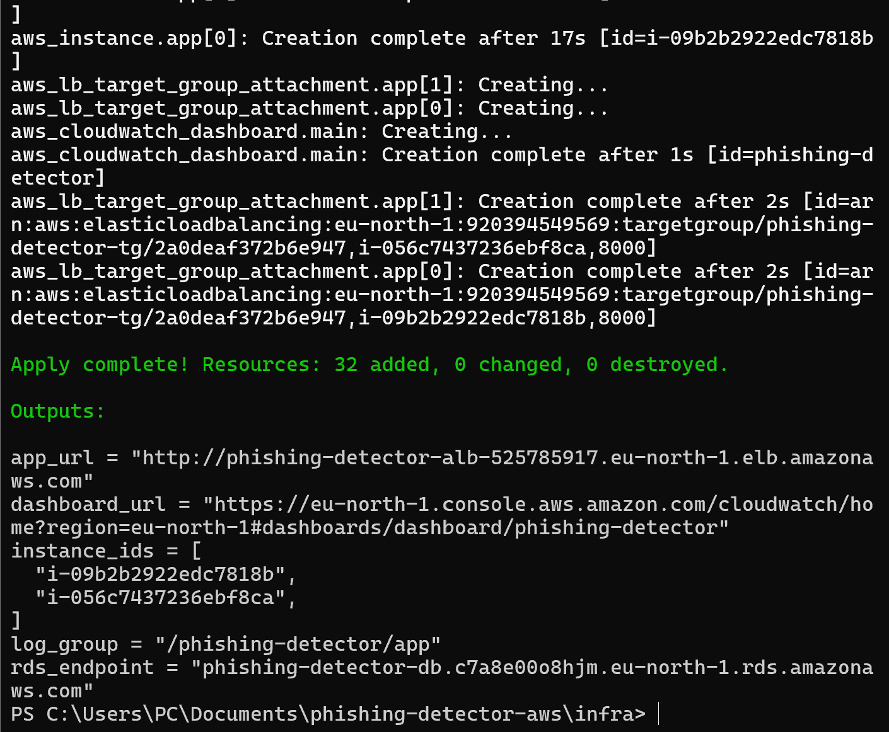 |
| Both targets healthy | 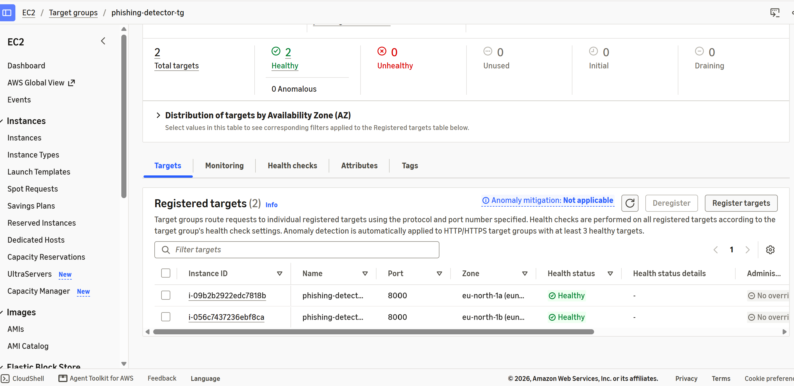 |
| Result and shared history (score 12 includes "flagged before") | 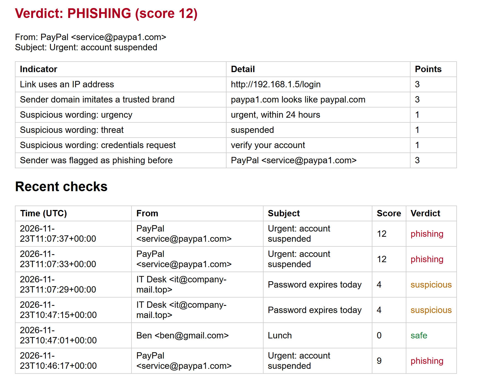 |
| Logs, one stream per server | 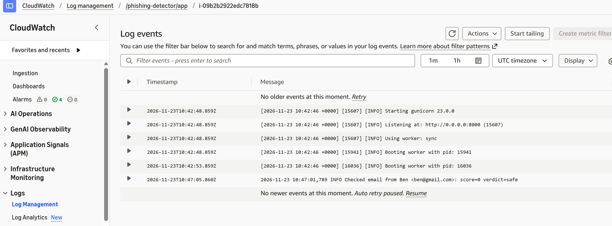 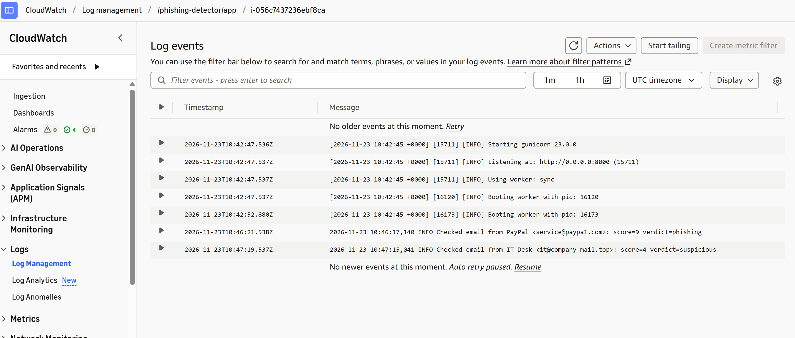 |
| Dashboard (last hour: boot, instance replacement, failover drill) | 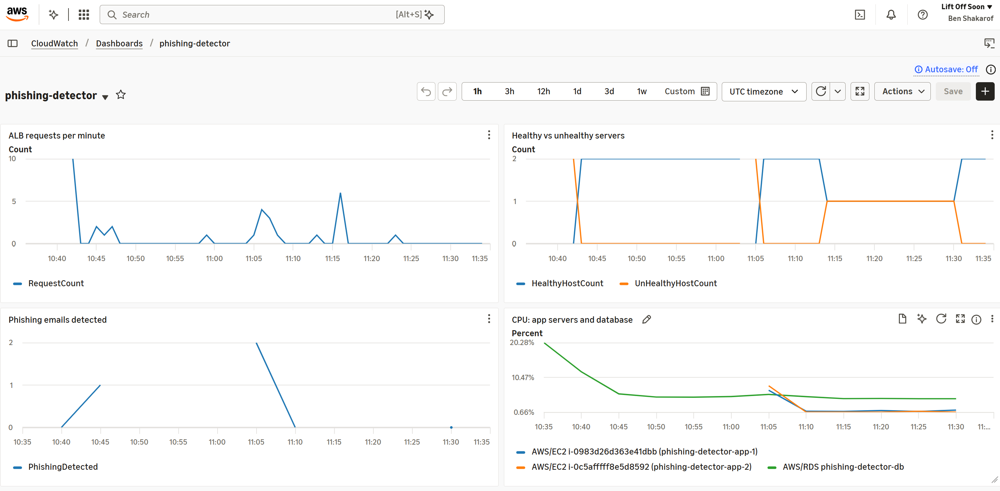 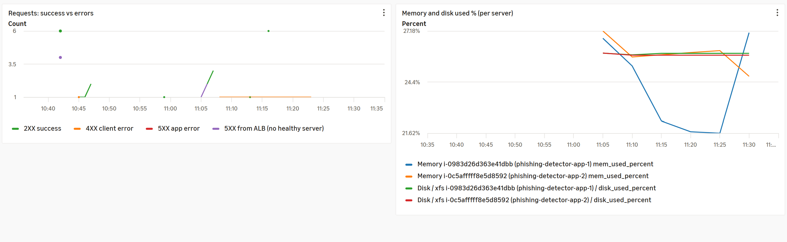 |
| Failover: one target unhealthy | 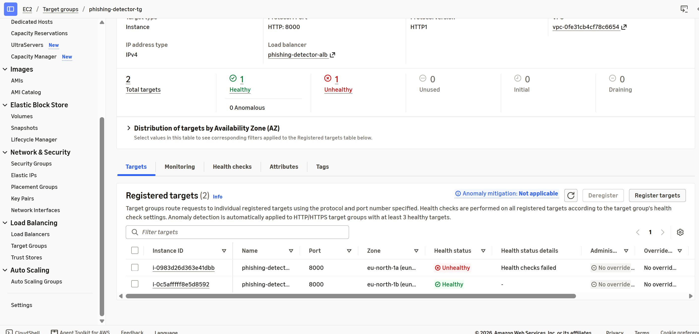 |
| Failover: alarm fired | 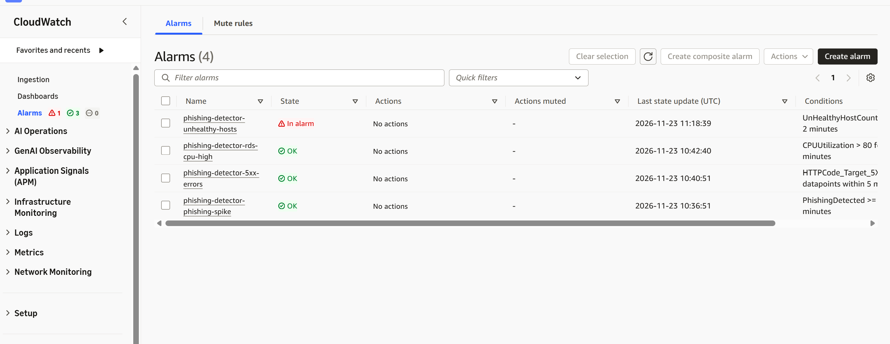 |
| Troubleshooting: service stopped | 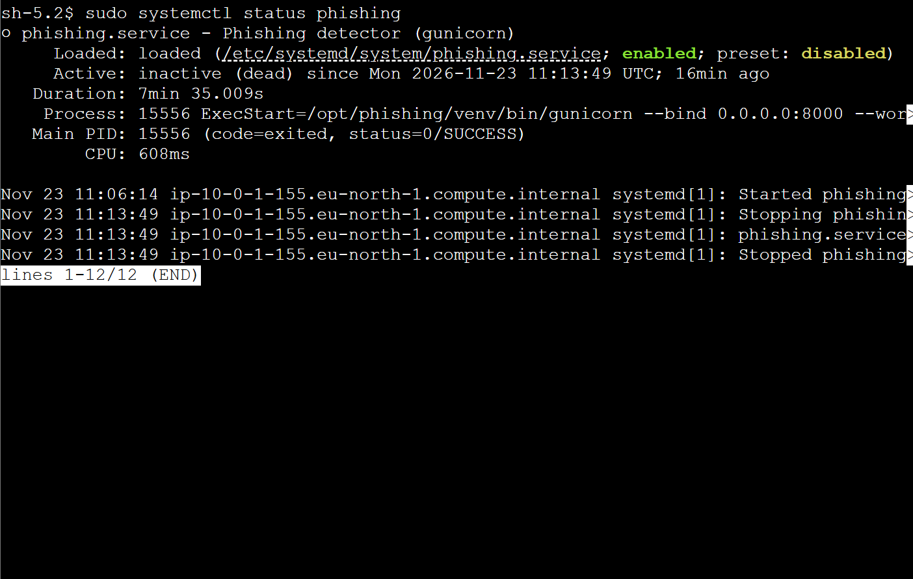 |
| Fix: service running again | 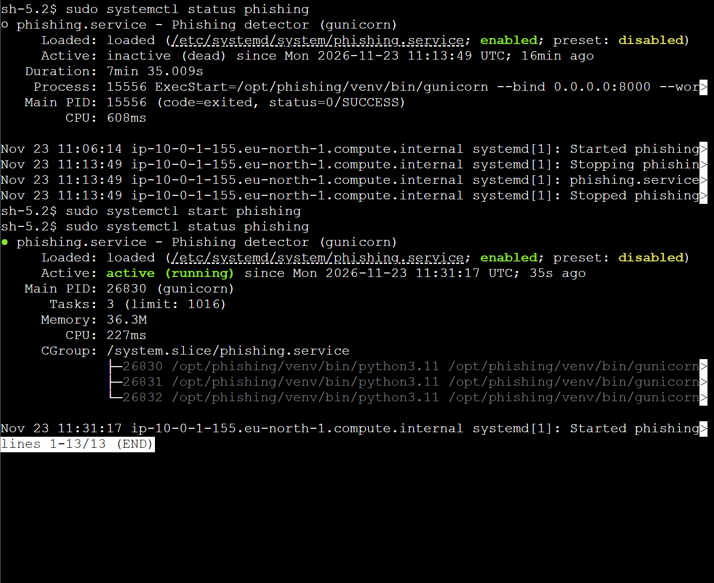 |
| All alarms back to OK | 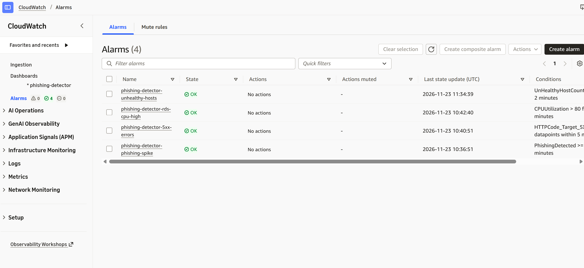 |
| Teardown: `terraform destroy` (32 resources destroyed) | 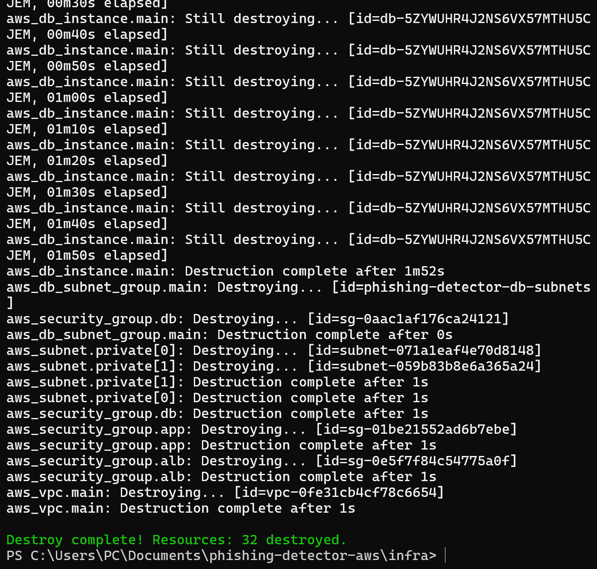 |
| **Bonus, ElastiCache:** apply with the cache (35 resources, `redis_endpoint` output) | 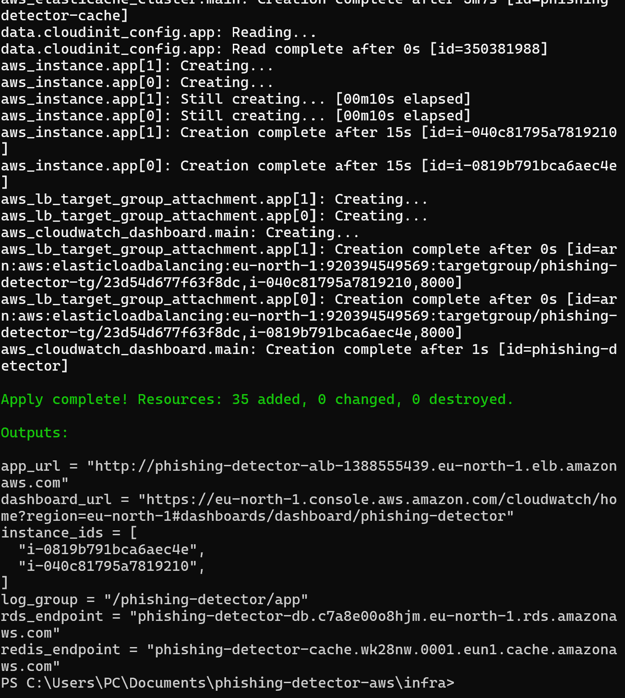 |
| Bonus: first check scored 9, later checks 12 ("flagged before" is always read from RDS, never cached); history updates right after each check | 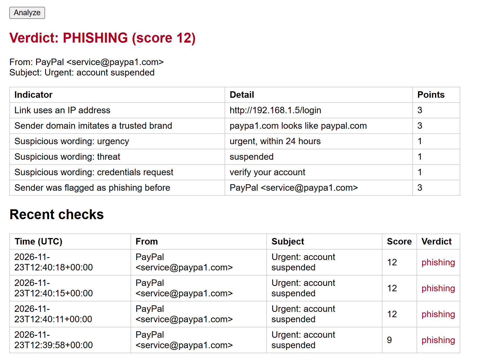 |
| Bonus: app logs `cache=hit` / `cache=miss` from both servers; every miss follows a new check (key deleted) or the 60 s TTL | 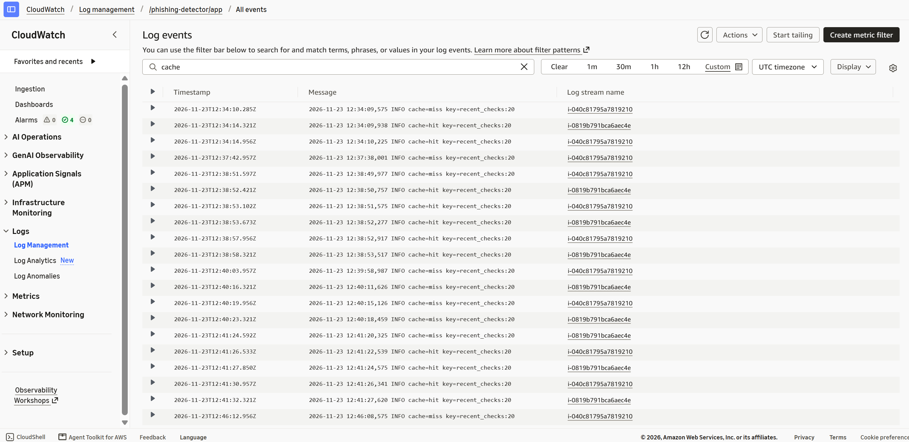 |
| Bonus: dashboard with the new **Cache hits vs misses** graph | 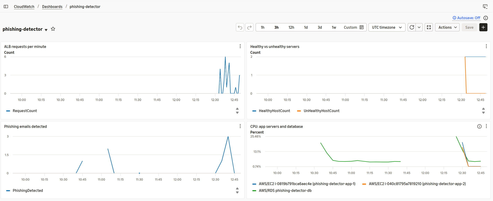 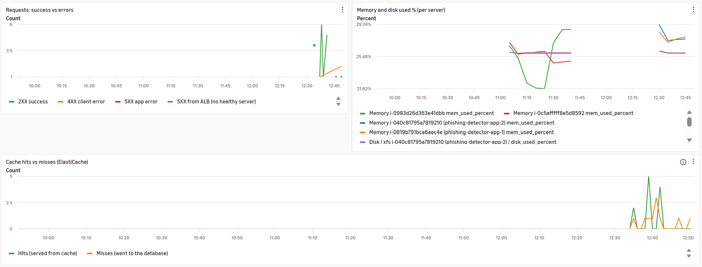 |
